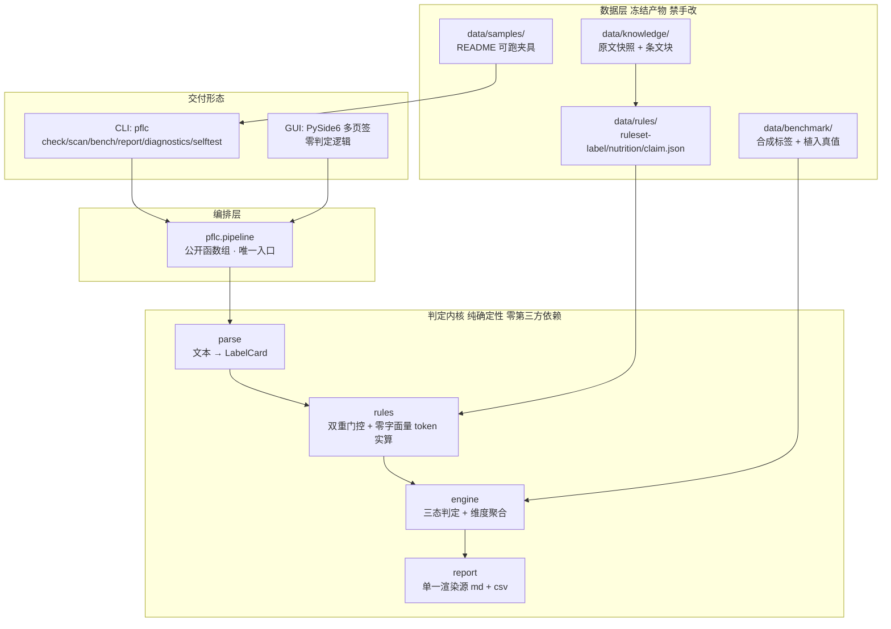
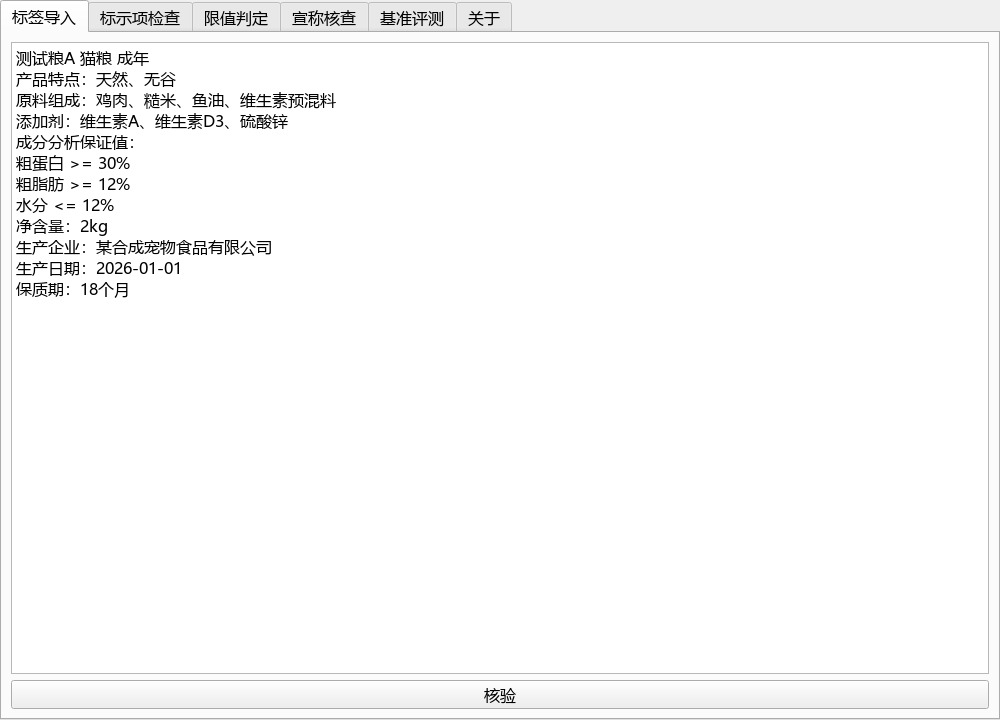

# 宠物食品标签合规比对器

**猫犬粮标签的国标口径合规规则引擎** —— 把《宠物饲料标签规定》的强制标示要求与 GB/T 31216/31217 的营养限值编码成**结构化规则**，对标签文本逐项给出**三态结论 + 条款锚点**，内置**合成标签基准**可复现评测。

> 纯本地零上传 · PySide6 桌面 exe + CLI 双形态 · 合成标签基准，零真实品牌 · **不使用 LLM**，结论 100% 由确定性规则产生

[](https://github.com/yuluo554/pet-food-label-checker/actions/workflows/ci.yml)

> **状态**：✅ **M0–M5 已完成**——判定引擎三模块（标示项 / 营养限值 / 宣称核查）齐备，规则包 **45 条**（`label` 8 / `nutrition` 32 / `claim` 5，其中 **43 条已挂原文核对、2 条 `pending`**）。基准四套件**全部达标**，且期望来源可核证：真值库 `data/benchmark/cases.json`（16 用例）入仓、基准真的读它、`gen_cases.py --check` 位级守门。桌面交付为 **onedir 双 exe**（GUI 111 MB / CLI 17 MB，两树均过冻结态验收）。未挂原文核对的规则不进入判定路径，报告会显式列出。
>
> **本地等价校验通过**（Python 3.8 与 3.12 双解释器 **295 项测试** + **七道 OK 标记门**（`TRANSCRIBE_OK` / `FROZEN_RULESET_OK` / `FROZEN_CASES_OK` / `FROZEN_SAMPLES_OK` / `DESSENSITIZE_AUDIT_OK` / `SMOKE_CLI_OK` / `RELEASE_PACK_OK`）+ 基准四套件达标）；**未接远端，CI 待首推验证**——未推送 = 未跑 CI。

---

## 下载即用（免安装 Python）

不想装 Python 的话，直接下打包好的 exe。**两个包是不同的形态，按需选一个**：

| 下载 | 大小 | 内含 | 适合 |
|---|---|---|---|
| [`pflc-gui-windows-x64-0.1.0.zip`](https://github.com/yuluo554/pet-food-label-checker/releases/download/v0.1.0/pflc-gui-windows-x64-0.1.0.zip) | 约 111 MB | 桌面版 `pflc.exe`（内嵌 PySide6） | 想用图形界面填表核验 |
| [`pflc-cli-windows-x64-0.1.0.zip`](https://github.com/yuluo554/pet-food-label-checker/releases/download/v0.1.0/pflc-cli-windows-x64-0.1.0.zip) | 约 17 MB | 命令行版 `pflc-cli.exe`（**特意不含 Qt**） | 只要命令行 / 脚本化核验 |

两个 `.zip` 的 sha256 见 [`docs/DIST-sha256-M6.txt`](docs/DIST-sha256-M6.txt)（可与 Release 页面对照核验）。

**用法**：解压到任意目录（**别放进本仓库树内**），双击 `pflc.exe` 即开；
命令行则在该目录下：

```bat
pflc-cli.exe diagnostics                       :: 看规则与数据状态
pflc-cli.exe check _internal\data\samples\label-demo-ok.txt
pflc-cli.exe bench                             :: 跑内置基准四套件
```

> **为什么 CLI 包不含界面**：它靠 `pflc-cli.exe gui` 走 **exit 3** 并提示改用桌面版来分流。
> 把 PySide6 塞进 CLI 包会让这句提示变成死代码，还白送约 87 MB —— 故两个包各管一段，
> 而非"打一个大包全塞进去"。

---

## 为什么需要它

养宠人核验一袋猫犬粮的标签，面对三个具体困难：

1. **标示项易漏** —— 通用名、成分分析保证值、原料组成、添加剂、净含量、生产者信息等强制标示项是否齐全，肉眼逐条对照规定必然漏项；
2. **限值无从判定** —— "粗蛋白 ≥26%" 到底达没达到国标对应生命阶段的限值，标准正文普通人拿不到也读不懂；
3. **宣称无据** —— "天然粮""无谷粮"是受规定约束的限定用语，营销话术是否越界无从判断。

商业侧的"AI 点评配料表"输出一段话，**不可复现、无条款依据**。本工具的做法是：把散在法规与国标里的**可机器判定的条款**抽成规则包，用**确定性引擎**逐项给出**带条款锚点的三态结论**。

**LLM 聊天给不了的四件事**：持久的条款规则库（口径不漂移）、逐项三态结论、可复现基准、可核证的条款锚点。

---

## 架构



**分层纪律**：判定逻辑**只有一份实现**，就在编排层之下；CLI 与 GUI 都是"取数 + 渲染"的薄壳。GUI 层"零判定逻辑"由 **AST 静态门禁**守住（三条齐上：不 import 规则层 + 无算术运算 + 无政策数值字面量）。

---

## 快速开始

```bash
# 1) 建虚拟环境（Windows 上用 py 启动器；venv 内一律用 python -m 调 pip，
#    因为 py 启动器会无视已激活的 venv）
py -m venv .venv
.venv\Scripts\activate          # Linux/macOS: source .venv/bin/activate
python -m pip install --upgrade pip
python -m pip install -e ".[dev]"

# 2) 看规则与数据状态
python -m pflc.cli diagnostics

# 3) 核验一份标签
python -m pflc.cli check data/samples/label-demo-ok.txt -v

# 4) 跑内置基准
python -m pflc.cli bench

# 5) 导出双轨报告（Markdown 人读 + CSV 机读）
python -m pflc.cli report data/samples/label-demo-missing.txt --out output/

# 6) 桌面应用（需额外装 GUI 依赖）
python -m pip install -e ".[gui]"
python -m pflc.cli gui
```

### 打包为桌面 exe（onedir 双 exe）

```bash
# 打 GUI（PySide6）必须 PyInstaller >=6；构建通路固定用 3.12
python -m pip install -e ".[gui,build]"
python -m PyInstaller --clean --noconfirm tools/pflc.spec

# 产物是两棵**独立的树**（不是同一棵树里的两个 exe）：
#   dist/pflc/pflc.exe               桌面版（约 112 MB，内嵌 PySide6）
#   dist/pflc-cli-dist/pflc-cli.exe  CLI 版（约 17 MB，**特意不含 Qt**）
```

**为什么 CLI 包不含 GUI**：它靠 `pflc-cli.exe gui` 走 **exit 3** 并提示"请改用桌面版"来分流。
把 PySide6 打进 CLI 包会让这句提示变成死代码，并白送约 87 MB 体积。

**构建后验收**（在**中立目录 + 剥离环境变量**下自动跑，别在仓库树内跑）：

```bash
python tools/verify_frozen.py --dist dist/pflc-cli-dist --selftest   # → VERIFY_FROZEN_OK
python tools/verify_frozen.py --dist dist/pflc --selftest            # → VERIFY_FROZEN_OK
```

它做四件事：① dist 内禁区成分扫描（**覆盖 PyInstaller 6.x 的 `_internal/` 布局**）；
② 内嵌数据与仓库逐份 sha256 对账；③ 白名单外多余数据目录检测；
④ 冻结态三连——自检（数据目录落在 exe 内 + 规则数 > 0）、CLI 五连（退出码逐条符合声明）、
GUI 存活探针（offscreen 真构主窗口，回传页签数）。

**打成发布 zip**（确定性：`ZIP_STORED` + 条目字典序 + 固定时间戳 1980-01-01）：

```bash
python tools/make_release.py --dist dist --out release --check
python tools/make_release.py --dist dist --out release --ledger docs/DIST-sha256-M6.txt
```

`--check` 同时做三件事：① **两次独立打包 sha256 必须一致**（否则"确定性"只是文档里的一句话）；
② **回读保真**（解出的条目与源树逐字节相同、条目名与时间戳符合声明口径）；
③ **产物本体脱敏扫描**——`dist/` 在 `.gitignore` 内，`audit_desensitize.py --tracked` **看不到它**，
故发行包要另立通路扫（按字面量精确编码 ASCII 与 UTF-16 两种形态）。

### 退出码语义

| 码 | 含义 |
|---|---|
| `0` | 无不符合 / 达标 |
| `1` | 检出不符合 / 基准未达标 / 有未生效规则被门控拦下 |
| `2` | 输入、坐标或用例名错误 |
| `3` | 缺可选依赖（GUI） |

> 退出码非 0 **不等于**跑挂。判据是"符合上表声明过的契约"。

### 可直接复制的示例输入

仓库自带五份合成夹具（由 `tools/gen_samples.py` 产出，纳入位级一致守门）：

| 文件 | 植入情形 |
|---|---|
| `data/samples/label-demo-ok.txt` | 全部强制项齐备、保证值达标 |
| `data/samples/label-demo-missing.txt` | 缺净含量 / 生产者 / 添加剂 |
| `data/samples/label-demo-overlimit.txt` | 保证值低于限值 |
| `data/samples/label-demo-claim.txt` | 宣称"天然、无谷"但缺原料组成支撑 |
| `data/samples/label-demo-edge.txt` | 解析层边界：产品类型词"全价"与"幼年"同现 / 净含量未知单位 `oz` / 非法日期 `2026-13-45` |

---

## 界面演示

`docs/demo/`（6 页签截图 + GIF）由 `tools/make_demo_assets.py` **程序化产出**，
两次独立生成的 sha256 逐个一致（`tools/check_demo_reproducible.py` → `DEMO_ASSETS_OK`）。

**自己重生成演示物料**需要额外的 `demo` extra（GIF 合成用 Pillow）：

```bash
python -m pip install -e ".[demo]"     # 只要重生成演示物料时才需要
python tools/make_demo_assets.py --out docs/demo
```



截图是**真实判定态**：灌入合成标签 → 点击"核验" → 出逐条结论；基准页含四套件实测值。
（早期物料是在空规则包态渲染的，判定页显示"零生效规则"、基准页空白——M5 已重生成。）

---

## 核心机制

### 三态判定 + 两种"非结论"

结论只有三态：`符合` / `不符合` / `未提供`。此外两种**非结论**必须可区分：

| 状态 | 语义 | 判据 |
|---|---|---|
| `skipped` | **不适用** | 只给"原文明确写了例外情形"的项；**绝不用于"缺材料/用户没做"** |
| `unknown` | **未观测** | "没看到"而非"缺失"，不计违规但计入待人工确认 |

三条硬纪律：

- **无条件义务缺失 = 不符合** —— 原文写"应当标示 X"而缺 X，记不符合。**"没做"绝不记成"不用做"**（那会让合规结论虚高）；
- **一条规则都不适用 → 该维度"未评估"**，绝不输出成"符合"（"没查出问题"与"没检查过"必须可区分）；
- **零生效规则的维度不参与聚合**，并显式记录原因码——否则会把整体结论无谓拉成"未评估"。

### 双重门控

每条规则挂**两个独立状态**：

| 字段 | 语义 | 作用 |
|---|---|---|
| `status` | **数值**核对状态 | **唯一门控判定路径**的开关 |
| `clause_status` | **条款号**核对状态 | 只管可证性展示，不阻断判定 |

耦合成单一状态的两个失败方向：条款号核不到 → 已核对数值也被无谓阻断；只看数值 → "条款号没核对却看起来已核对"。两个状态都在报告里显式可见。

门控还**按计算路径分作用域**（`label` / `nutrition` / `claim`），各只校验自己引用的条目。

### 数值口径一处定义

限值数值**只存在于规则包**一处，判定、报告、基准全部引用它。配套**零政策字面量门禁**：把全部规则包数值收编为禁用 token（**运行时实算，不写死在扫描器里**），扫描引擎/基准/CLI/GUI 源码，**含 docstring 与注释**。

> **豁免口径**：整数形态且 < 20 才豁免（下标/计数），**非整数一律不豁免**。原口径"绝对值 < 100"在真实国标数据下会把**全部百分比限值整包放过**——门禁空转 = 假门。故门禁另配"真实规则包下 token 集非空"的守门测试。

### 数值基准（干物质 vs 标示状态）

GB/T 31216/31217 的理化指标表头写明 **"指标（以干物质计）/%"**，而标签保证值是**按标示状态（as-fed）**给的。**两者基准不同，直接比会造假结论**：高水分湿粮标示的百分数换算到干基后显著变大，直接比会误判为不符合。

规则条目带 `basis` 字段；引擎对干基规则先做 `干基值 = 标示值 / (1 - 水分% / 100)` 再比；**水分未标示 → 记 `unknown` + 原因码 `basis_undetermined`**，绝不拿未换算的值直接比、也绝不猜一个水分。换算过程写进结论，报告里可见。

### 原文核对：脚本转写，禁手抄

`tools/transcribe_clauses.py` 把原文快照转成条文块，**每一处抽取值都断言在原文里逐字出现**——手抄的数字没有任何机制保证它来自原文，抄错一位，"引擎对不对"就再也无法与"数据对不对"分离。转录规格（"哪条规则取哪处原文"）作为数据放在 `data/knowledge/transcription/spec.json`。

### 规则包是冻结产物

改需求走 `tools/transcribe_clauses.py --force` → `tools/gen_rulesets.py --force` 整目录重生成，配 `--check` 位级一致守门——规则包一旦可手改，"引擎对不对"就永远无法与"数据对不对"分离。

---

## 评测

基准四套件，一条命令跑全（`python -m pflc.cli bench`）：

| 套件 | 类型 | 测什么 |
|---|---|---|
| `detection` | 样本驱动 | 违规检出率 + 误报率 |
| `overall` | 样本驱动 | 整体结论一致率 |
| `boundary` | **规则驱动** | 从规则表推导限值端点，做 ±0.01 邻域断言 |
| `traceability` | 结构性 | 锚点可解析率 |

三条配套纪律：

- **样本驱动 + 规则驱动两层** —— 样本驱动只证明"在真值库覆盖的样本上对"；规则驱动不读真值库，证明"在*所有*有限端点上对"；
- **验收门槛随 manifest 下发**（数据非代码）—— 门槛内联在引擎里就是"抄进代码的第二份真相"；缺失即报配置错误，**不回落代码默认值**；
- **每套件配探活测试** —— 注入缺陷后基准必须报未达标；且期望锚定冻结真值（不与引擎共用通路），否则探活是永远绿的假门。

**空分母不冒充通过**：零样本时 `not_enabled=true` + notes 声明"该类用例未生成" + **exit 1**（`hits(0) <= max(0)` 恒真就是假门）。

### 实测指标（M4 末态）

下表的数值取自 `python -m pflc.cli bench` 的实际输出（**不手抄**——`tests/test_readme_bench_metrics.py` 会把 README 里的数与实跑结果逐项比对，手改 README 不会变绿）：

| 套件 | 实测指标 |
|---|---|
| `detection` | `violation_cases=12`、`detected=12`、`detection_rate=1.0`、`false_positive_rate=0.0`（合规样例 4 件零误报） |
| `overall` | `cases=16`、`matched=16`、`accuracy=1.0` |
| `boundary` | `rules=30`、`checked=60`、`passed=60`、`rate=1.0`（±0.01 邻域两侧断言全中） |
| `traceability` | `effective_rules=43`、`resolvable=43`、`rate=1.0` |

> **真值来源可核证**：`detection` 与 `overall` 的 metrics 里带 `truth_source=frozen`
> ——基准读的是入库冻结真值库 `data/benchmark/cases.json`，不是每次现场重算。
> 该入库件配 `python tools/gen_cases.py --check` 常驻守门（入库件与生成器输出位级一致），
> CI 亦跑此步。基线偏离即报配置错误（exit 2），**不静默重算**。

> **当前状态**：规则包已录入并逐条核对，四套件**全部达标**（`bench` 返回 exit 0）。阈值由 `manifest.json` 随规则包下发（`min_accuracy` / `max_false_positive`），基准层只读、不回落代码默认值。

---

## 数据来源与纪律

| 依据 | 编号 | 状态 |
|---|---|---|
| 宠物饲料标签规定 | 农业农村部公告第 20 号 附件 3 | ✅ **M1 已获取全文并逐条核对**（FAO 库扫描件 + feed-china 转载交叉校验；8 + 5 条规则 verified） |
| 标签过渡期延长 | 农业农村部公告第 210 号 | ✅ 权威转载可读（标签强制标示自 2020-03-01 全量执行） |
| 全价宠物食品 犬粮 | GB/T 31216—2014 | ✅ 现行无迭代；**M1 已获取数值表并核对**（瓦片精灵图旁路 + 逐格 OCR） |
| 全价宠物食品 猫粮 | GB/T 31217—2014 | ✅ 同上（30 条营养限值 verified / 2 条 pending） |

- **数值规则条数不预设硬数字** —— 以全文录入逐条核对后的条目为准；
- **未挂原文核对不得生效** —— `status=pending` 的规则不进判定路径；
- **演示与基准一律合成标签** —— 假品牌名白名单（"测试粮A"…），禁止真实品牌入库为基准样例；
- **真值样例严格隔离** —— 公开实测保证值仅作录入核对参照，不入基准真值库。

详见 [data/README.md](data/README.md)（数据台账：来源/许可/三态/sha256/基准日）。

---

## 目录结构

```
plan/          计划文档（00 总览 / 01 题面 / 02 需求 / 03 架构 / 04 详设 / 05 数据 / 06 里程碑 / 07 对标与决策）
data/          数据层（knowledge 原文快照 / rules 冻结规则包 / samples 夹具 / benchmark 真值库）
src/pflc/      主包（model / parse / rules / engine / report / pipeline / cli / gui / benchmark）
tools/         生成器与守门脚本（gen_rulesets / gen_cases / gen_samples / audit_desensitize / verify_frozen / smoke_cli / check_demo_reproducible / entry_cli / entry_gui / pflc.spec）
tests/         测试（含零字面量门禁 / AST 分层门禁 / EOL 门禁 / 探活变异验证）
docs/          技术报告与演示物料
```

---

## 限制（请先读这一节）

- **首期只接贴文本** —— 不做图片 OCR，不做多语言标签；
- **只做"可机器判定"的核查** —— 文本型条款（用语格式、字号级别）只判"是否提供/是否含关键词"，**自由文本语义不做硬判**；"配料是否确为天然"这类语义问题**不判**，只核查"宣称存在 → 其适用条件所要求的信息支撑是否齐备"；
- **不做**喂食建议、营养配方推荐、健康诊断、疾病与过敏判断、电商比价、监管申报对接；
- **规则覆盖以录入核对进度为准** —— 未核对条目在报告"未启用清单"里显式列出，不静默省略；
- **AAFCO/FEDIAF 横向对照、旧版标签三态对照、卫生规定限量包、图片 OCR** 均为扩展项，首期不承诺交付。

### 免责声明

**本软件输出为基于公开法规条款与国家标准限值的合规检查发现，不构成产品合格判定、检测结论或行政认定，也不构成兽医意见。正式结论以具备资质的检验检测机构报告与主管部门口径为准；宠物健康问题以执业兽医意见为准。**

---

## 已知环境问题

| 现象 | 原因与处置 |
|---|---|
| 3.8 上 `pip install -e .` 失败 | py3.8 自带 pip 20.2.3 无法可编辑安装 pyproject-only 项目 → 先 `python -m pip install --upgrade pip`（README 已含该行） |
| `py` 启动器无视已激活的 venv | 本机已知行为 → README 的 venv 段落一律用 `python -m pip ...` |
| 中文在控制台显示乱码 | 入口已按 `stream.encoding` 探针 reconfigure；若仍异常，用 `py -X utf8` 跑 |
| GUI 依赖装不上（3.8） | PySide6 6.7+ 元数据要求 Python ≥3.9；3.8 上实测可解析最高版为 6.6.3.1（extras 已写 `>=6.5,<6.7`） |
| 打包 GUI 崩在 `Instruction object is not iterable` | PyInstaller 5.x 无法扫 PySide6 字节码 → 打 GUI 必须 PyInstaller ≥6（`build` extra 已按 Python 版本分档） |
| `tools/pflc.spec` 未入仓 | `.gitignore` 的 `*.spec` 通配会吞掉它 → 已加 `!tools/*.spec` 例外 |

---

## 开发

```bash
python -m pytest -q                     # 全量测试
python tools/transcribe_clauses.py --check  # 条文转录位级一致守门
python tools/gen_rulesets.py --check    # 规则包位级一致守门
python tools/gen_cases.py --check       # 冻结真值库位级一致守门
python tools/gen_samples.py --check     # 夹具位级一致守门
python tools/audit_desensitize.py --selftest   # 脱敏审计器阳性/阴性对照
python tools/audit_desensitize.py --tracked    # 已跟踪文件脱敏审计（HARD 0 / REVIEW 0）
python tools/smoke_cli.py               # CLI 端到端（断言退出码契约）
python tools/check_demo_reproducible.py # 演示物料两次生成 sha256 一致 + 对账留档
python tools/make_release.py --dist dist --out release --check  # 发布 zip 确定性 + 回读保真 + 产物脱敏
```

CI 四矩阵：`windows×{3.8,3.12} + ubuntu×{3.12}`，外加一个 `package` job
（真构建 onedir 双 exe → 两树冻结态验收 → 演示物料可复现性 → 发布 zip 打包与三条判据）。

---

## 计划文档

| 文档 | 内容 |
|---|---|
| [plan/00-README总览.md](plan/00-README总览.md) | 项目总览、决策记录、承诺-证据台账 |
| [plan/01-题目文档.md](plan/01-题目文档.md) | 题目全文（介绍/任务/材料/评分/锚点/边界） |
| [plan/02-需求解读.md](plan/02-需求解读.md) | 痛点→能力转译、FR 清单、边界与非目标 |
| [plan/03-架构与技术选型.md](plan/03-架构与技术选型.md) | 分层架构、技术选型、关键设计决策 |
| [plan/04-模块详设.md](plan/04-模块详设.md) | 逐模块接口与判定语义 |
| [plan/05-数据计划.md](plan/05-数据计划.md) | 数据先行、规则包形态、基准真值语义 |
| [plan/06-里程碑.md](plan/06-里程碑.md) | M0–M6 目标/DoD/风险降级 |
| [plan/07-交付对标与决策记录.md](plan/07-交付对标与决策记录.md) | 评分对标、决策记录、既定口径清单 |

---

## 许可

MIT，见 [LICENSE](LICENSE)。
